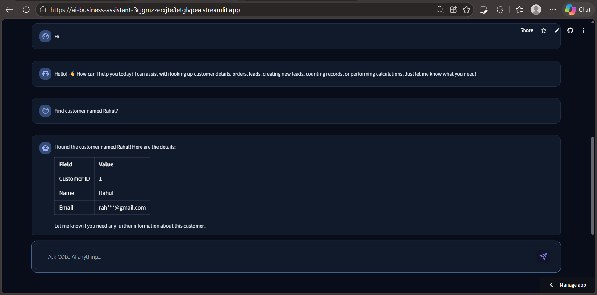

## COLC AI — AI Business Operations Assistant

COLC AI is an AI-powered business operations assistant that allows users to interact with business data through natural language.

It uses an AI agent with tool-calling capabilities to retrieve customer, order, and lead information from a PostgreSQL database and create new leads.

## Live demo
- **Application:** [Try COLC AI] (https://ai-business-assistant-3cjgmzzerxjte3etglvpea.streamlit.app)
- **Backend API:** [FastAPI Backend] (https://ai-business-assistant-c-baf1.vercel.app)
- **API Documentation:** [Swagger UI] (https://ai-business-assistant-c-baf1.vercel.app/docs)

* Response time depends on the content and model availability.
* Model can give temporary request limit errors.
* Initial requests can be slow due to free hosting.

  ## Screenshots

### Main Dashboard


### Customer Search


### Order Search


### Lead Creation


### Lead search

  
## Features
- **Customer Search:** Retrieve customer information using natural language.
- **Order Search:** Find orders and check their details and status.
- **Lead Search:** Retrieve lead information.
- **Lead Creation:** Create new leads through conversational instructions.
- **AI-Powered Interaction:** Uses an LLM agent and function/tool calling to interpret user requests and execute operations.

## Technology Stack

| Component | Technology |
|---|---|
| Frontend | Streamlit |
| Backend | FastAPI |
| Database | PostgreSQL |
| Database Hosting | Neon |
| Backend Hosting | Vercel |
| Frontend Hosting | Streamlit Community Cloud |
| ORM | SQLAlchemy |
| AI Integration | OpenAI API |
| Testing | Pytest, GitHub Actions |

## Architecture

```text
User
  |
  v
Streamlit Frontend
  |
  v
FastAPI Backend
  |
  v
AI Agent
  |
  v
Tool Calling
  |
  v
SQLAlchemy ORM
  |
  v
Neon PostgreSQL
```

## Project Structure

```text
AI-Business-assistant/
│
├── backend/
│   ├── api.py
│   ├── database.py
│   ├── llm.py
│   ├── seed.py
│   ├── tools.py
│   └── __init__.py
│
├── frontend/
│   ├── app.py
│   └── style.css
│
├── .github/
│   └── workflows/
│       └── tests.yml
│
├── .streamlit/
├── .gitignore
├── pyproject.toml
├── requirements.txt
└── README.md
```

## Installation and Local Setup

### 1. Clone the repository

```bash
git clone <YOUR_GITHUB_REPOSITORY_URL>
cd AI-Business-assistant
```

### 2. Create a virtual environment

```bash
python -m venv venv
```

Activate it:

Windows:
```powershell
venv\Scripts\activate
```

### 3. Install dependencies

```bash
pip install -r requirements.txt
```

### 4. Configure environment variables

Create a `.env` file in the project root.

Configure the required database connection string and LLM API key using the variable names expected by the backend.

Never commit your `.env` file or expose API credentials.

### 5. Run the application

Start the backend:

```bash
uvicorn backend.api:app --reload
```

Start the frontend in another terminal:

```bash
streamlit run frontend/app.py
```

## Deployment

The application uses a split deployment architecture:

- **Frontend:** Streamlit Community Cloud
- **Backend:** Vercel
- **Database:** Neon PostgreSQL

## Current Project Scope

COLC AI is currently a portfolio and demonstration project using synthetic business data.

It supports customer search, order search, lead search, and lead creation.

Creating customers and orders, integrating external business platforms, and supporting multiple independent client databases are not currently implemented.

## Future Improvements

- Integration with external CRM and e-commerce platforms.
- Multi-tenant database architecture.
- Additional business operations and automation tools.
- Improved authentication and access control.
- Expanded automated testing.
- Add additional features as chat history

## Author

Developed as an AI engineering portfolio project.
